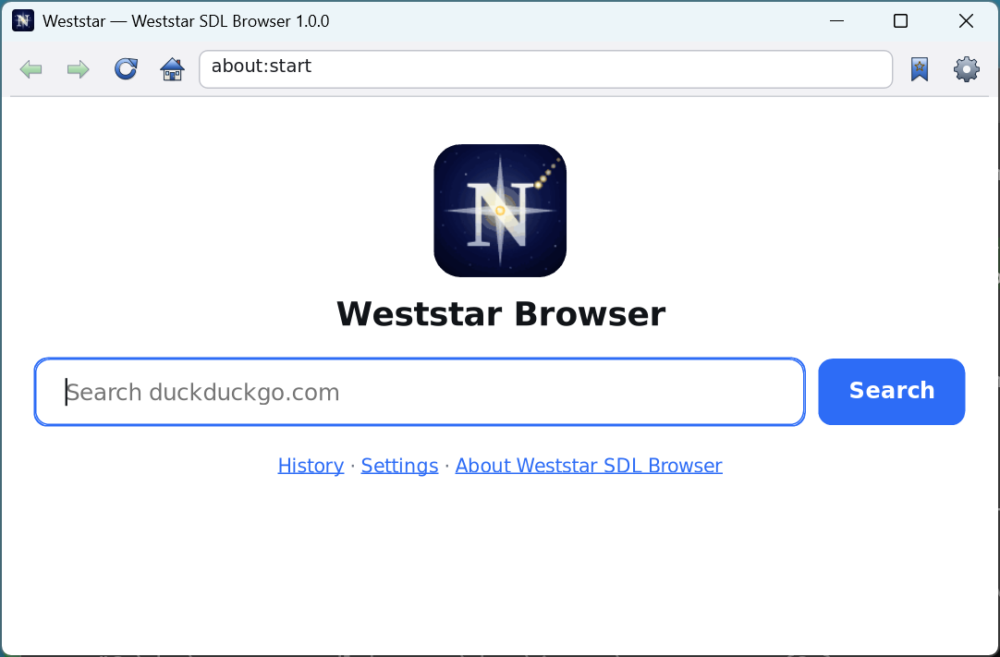

# Weststar SDL Browser

Weststar SDL Browser is a fork of the
[Northstar Web Browser](https://github.com/nordstjernen-web/northstar-web-browser)
in which the GTK 4 user interface and the Cairo 2D renderer are being
replaced by [SDL3](https://libsdl.org). The page engine is Northstar's
hand-written C engine: lexbor for HTML parsing, its own CSS cascade and
layout, QuickJS-ng for JavaScript, libcurl for the network.

It is licensed under the GNU General Public License, version 3 or later.



## Status

This is the start of the port. The work is done in stages, each merged to
`main` while it builds and runs:

| Stage | What | State |
|-------|------|-------|
| 1 | Import Northstar without history, rebrand | done |
| 2 | Remove WebGL, WebGPU and `<video>` | done |
| 3 | Replace the GTK shell with an SDL3 shell, chrome drawn with Nuklear | done |
| 4 | Replace Cairo with an in-tree rasterizer drawing into SDL surfaces | in progress: `src/gfx/` written, the chrome draws with it |

See [docs/porting-to-sdl.md](docs/porting-to-sdl.md) for the plan, what
has been removed and why, and what is left.

What is deliberately **not** in Weststar for now:

- **WebGL 1/2 and WebGPU.** `canvas.getContext("webgl")` returns `null`.
- **`<video>`**, Media Source Extensions and camera capture. A `<video>`
  shows a dark box with its controls; `<audio>` still plays through SDL3's
  audio device.
- **Printing and PDF export** (`--export=pdf:`), removed for now while
  Cairo is replaced; they will come back without it.
- Parts of Northstar's GTK chrome not ported yet: the developer-tools
  window, address-bar suggestions and the downloads list (downloads
  report in the status bubble).

## Building

Weststar builds with meson and ninja. On Debian/Ubuntu:

```sh
sudo apt install build-essential pkg-config meson ninja-build \
    libsdl3-dev libcurl4-openssl-dev libssl-dev libharfbuzz-dev \
    libfribidi-dev libcairo2-dev libfontconfig-dev libfreetype-dev \
    libpsl-dev libsqlite3-dev libseccomp-dev libglib2.0-dev zlib1g-dev
meson setup builddir
meson compile -C builddir
./builddir/src/sdl/weststar https://example.org
```

On Windows, Weststar builds in an MSYS2 UCRT64 shell with the same
commands; [docs/building.md](docs/building.md#windows-msys2) lists the
packages.

SDL3 3.2 or newer is required; GTK is not. Distributions without an SDL3
package (Ubuntu 24.04, Debian 12) can build it from the
[SDL release tarball](https://github.com/libsdl-org/SDL/releases) with
CMake; [docs/building.md](docs/building.md) has the commands.

## The window

The SDL shell (`src/sdl/`) opens one SDL window per browser window. The
page is rendered on the engine thread and uploaded to an SDL texture,
only the damaged rectangles when the engine reports them. The chrome is
built every frame with [Nuklear](https://github.com/Immediate-Mode-UI/Nuklear),
an immediate-mode GUI library: back, forward, reload/stop, home, the
address bar, a bookmark star and a menu; a find bar (Ctrl+F), a context
menu, and a status bubble for hovered links and messages. Nuklear's draw
commands are rendered by `src/gfx/`, Weststar's own 2D rasterizer, with
text from the engine's own text stack, so the chrome shows any script the
page can.

Keyboard: Ctrl+L / F6 address bar, Ctrl+F find, F3 / Ctrl+G next match,
Alt+Left / Alt+Right back and forward, F5 / Ctrl+R reload, Ctrl+D
bookmark, Ctrl+N new window, Ctrl+W close, Ctrl+Q quit, Ctrl+= / Ctrl+- /
Ctrl+0 zoom, F11 full screen.

Headless mode is unchanged from Northstar and needs no display:

```sh
./builddir/src/sdl/weststar --headless --dump=text https://example.org
./builddir/src/sdl/weststar --headless --dump=png:page.png https://example.org
```

## Relationship to Northstar

Weststar keeps Northstar's internal names (`ns_` prefixes, file names such
as `libnorthstar.c`) so that fixes to the shared engine can be carried
between the two trees. User-visible names, the executable (`weststar`)
and the profile directories (`~/.config/weststar`, `~/.local/share/weststar`,
`~/.cache/weststar`) are Weststar's own, so the two browsers can be
installed side by side.

The other browsers of the same family are
[Nordstjernen Sol](https://github.com/nordstjernen-web/nordstjernen-sol-browser),
[Northstar](https://github.com/nordstjernen-web/northstar-web-browser) and
[Southstar](https://github.com/nordstjernen-web/southstar-browser).
