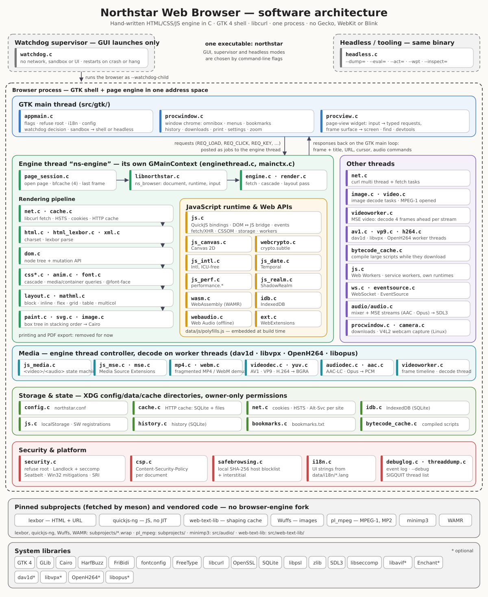

# Northstar Web Browser architecture



This document maps the Northstar Web Browser codebase: the process and thread model,
the page-load pipeline, and which source file owns which job. It describes
the **minimalist GPL edition**, which is single-process and hand-written
(no forked browser engine). For the security posture of each layer see
[`security-model.md`](security-model.md).

## Process model

This edition runs the engine **in the shell process**. There is no
per-tab or per-origin renderer process; every page shares one address
space.

```
 watchdog supervisor  (watchdog.c, GUI launches only)
    │  re-executes the binary with --watchdog-child,
    │  restarts it on crash or hang, restores the session
    ▼
 browser process  (appmain.c → src/sdl/)
    ├─ main thread: SDL windows, Nuklear chrome, page views (src/sdl/*.c)
    ├─ engine thread "ns-engine", own GMainContext         (enginethread.c)
    │     fetch → parse → style → layout → paint, page JS, timers
    ├─ curl multi thread + fetch tasks                      (net.c)
    ├─ background compile of large scripts (≤ 2)           (bytecode_cache.c)
    ├─ image decode tasks                                   (image.c)
    ├─ JS worker threads: Web Workers, service workers      (js.c)
    ├─ WebSocket and EventSource threads                    (ws.c, eventsource.c)
    ├─ audio mixer thread → SDL3                            (src/audio/audio.c)
    └─ download threads                                     (src/sdl/window.c)

 headless / tooling  (--headless, --dump=, --export=, --eval=, --act=, --wpt, …)
    the same binary, never supervised, no window           (headless.c)
```

- **Entry point** (`appmain.c`) — handles `--version`, refuses to run
  privileged, loads the UI catalogue and configuration, decides whether to
  supervise, applies the sandbox, parses the remaining flags and starts
  either the SDL shell or the headless driver.
- **Watchdog supervisor** (`watchdog.c`) — a normal GUI launch first
  becomes a small parent that initialises no network, sandbox or UI and
  runs the real browser as a child (`--watchdog-child`). The child beats
  a counter from the main loop every two seconds; a thread in the
  child exits it when the beat stops for 60 seconds plus the configured
  JavaScript budget. The supervisor restarts a crashed or hung child with
  the saved session, and gives up after more than five failures within a
  minute. It is on by default (`--no-watchdog`, `NS_NO_WATCHDOG` or the
  `watchdog_enabled` setting turn it off); headless and tooling runs are
  never supervised. A hang on the engine thread alone does not stop the
  heartbeat, since it is the main loop that beats.
- **SDL shell** (`src/sdl/window.c`) — one SDL window per browser
  window, with its chrome built every frame with Nuklear
  (`src/sdl/nkui.c`): back, forward, reload/stop, home, the address bar,
  bookmark star and menu, the find bar, the context menu and the status
  bubble; downloads, session saving and shortcuts. *New Window* opens
  another window in the same process; each window shows one page — there
  are no tabs. Its icons are the bundled SVGs drawn by the in-engine SVG
  renderer (`src/sdl/icons.c`). `src/sdl/mainloop.c` runs the default NsLoop
  and SDL's event queue together on the main thread.
- **Page view** (`src/sdl/pageview.c`) — shows a page in part of a
  window. It turns SDL input into typed requests (`REQ_LOAD`,
  `REQ_RENDER`, `REQ_CLICK`, `REQ_KEY`, `REQ_SCROLL`, …), posts each as a
  job to the engine thread (`enginethread.c`), and receives the matching
  response — the frame's pixels, or only its damaged rectangles, plus
  title, URL, cursor and download side information — back on the main
  loop, where they are uploaded to an SDL texture. Both ends are in this
  process; nothing is serialised.
- **Engine thread** (`src/sdl/enginethread.c`) — one dedicated thread
  with its own `GMainContext`, so page timers, fetch completions and
  nested settle loops never block the main loop. Engine code attaches
  its timers and idle sources through `mainctx.c`, which resolves to that
  context in the GUI and to the default context headless.
- **Page session** (`page_session.c`) — owns the open page, a
  back/forward cache of up to four suspended pages, the pending POST body
  and the last frame. The view drives it on the engine thread.
- **Frame scheduling.** The view does not poll. A wake source on the
  engine context asks the view for a frame only when the page has
  something to show: a DOM mutation, a pending `requestAnimationFrame`, a
  loaded image, a canvas draw, a scroll or a navigation.
  The view then renders at once, and it keeps a 60 Hz timer only while
  the page animates continuously (CSS
  animations, animated images, `requestAnimationFrame` loops,
  layout the dampener deferred) or a caret blinks. `requestAnimationFrame`
  and CSS animations are sampled at the frame clock's time. Canvas
  drawing repaints without a relayout, and wheel scrolls and resizes that
  arrive while one is in flight are merged into the next request.
- **Damage tracking** (`damage.c`, `page_session.c`). A canvas draw, an
  element scroll, an animated image frame and a caret blink
  report the element they changed, and the frame repaints only those
  boxes' rectangles; a scroll of the page shifts the previous frame and
  paints the rows that came into view plus the `position: fixed`
  elements. Anything else — a relayout, a restyle, a CSS animation, a
  generic repaint request — repaints the whole viewport, and so does a
  change under a transform or a sticky or multi-column ancestor, or on a
  page with 3D transforms; scrolling repaints everything on pages with
  sticky elements or `background-attachment: fixed`. Every frame is
  painted with 48 rows of margin beyond the viewport and each damaged
  band with the same margin, so text crossing a clip edge renders the
  same whether a pixel came from a full or a partial repaint. The view
  copies only the changed rectangles into its frame.
- **Page host** (`libnorthstar.c`) — the `ns_browser` object beneath the
  session: one document, its QuickJS runtime, input dispatch, the settle
  loop, find-in-page and viewport scroll snapping. It is an
  internal interface; the embeddable library API of the full Nordstjernen
  edition is not part of this one.
- **Media controller** (`js_media.c`) — the `HTMLMediaElement` state
  machine: resource selection, `networkState`/`readyState`, `paused`,
  `ended`, `seeking`, `error`, the event sequence from `loadstart` to
  `ended`, the promise `play()` returns, `loop`, `muted`, `volume` and
  `autoplay` (muted, or after a user gesture). Each `<audio>` element gets
  a player whose backend is the audio mixer. Weststar decodes no video: a
  `<video>` with a source fails with `MEDIA_ERR_SRC_NOT_SUPPORTED` and
  paints as a dark box (or its CSS background) with its controls, and there
  is no `MediaSource`. Commands go straight to the backend; the
  controller polls it every 50 ms while something loads or plays and
  turns what it reports into events, `timeupdate` every 250 ms. An
  element removed from the document pauses, a new `src` starts over,
  and a page parked in the back/forward cache pauses everything. The
  `controls` bar is laid out once by `ns_media_controls_layout`, which
  both `paint_media_controls` (`paint.c`) and the hit test in
  `libnorthstar.c` call, so the two cannot disagree.
- **Audio mixer** (`src/audio/audio.c`) — one worker thread per process
  fetches `<audio>` through `net.c` (or takes bytes already in hand: a
  `blob:` URL), decodes it into memory and mixes every player into the
  SDL3 device; an MPEG-1 system stream plays its MP2 track. Web Audio
  pushes rendered PCM into a persistent SDL audio stream instead, whose
  playback cursor sets the stream's clock; headless runs use a silent
  clock-driven output instead. Each page owns an `NsAudioContext`, and
  `ns_audio_context_status` reports a player's load state, error,
  duration, position and end synchronously. Without SDL3 the build uses
  `src/audio/stub.c`, and every player fails as having no device.

### Headless drivers

`headless.c` has two paths. Text, DOM and layout dumps, `--dump=none`,
`--eval` and `--act` go through `page_session.c` and `libnorthstar.c`, the
same host the GUI uses. PNG dumps, `--wpt` and
`--inspect`/`--inspect-at` drive `engine.c` directly: they parse, lay
out, run the page's scripts and relayout without a page session.
`NS_HEADLESS_LEGACY` sends every run down the second path.

## Page-load pipeline

Each navigation flows through these stages. `engine.c` holds the
synchronous fetch → cascade → layout → capture steps and the speculative
preload scan; `render.c` is the shared style-and-layout pass (cascade,
layout, and the container-query second pass) that the GUI and headless
drivers both call.

| Stage | File(s) | Job |
|-------|---------|-----|
| 1. Fetch | `net.c`, `cache.c`, `engine.c` | libcurl on a shared multi handle (HTTP/1.1, HTTP/2; HTTP/3 through Alt-Svc when libcurl supports it), TLS verification, redirect clamp, response-size cap, HSTS, Alt-Svc, per-site cookie jars and HTTP cache. `engine.c` scans a parsed document for its scripts and stylesheets and preloads them; a preload map, an in-flight coalescer and the HTTP cache then answer in that order, keyed on request identity rather than bare URL, so a subresource is fetched once. A preloaded script of 64 KB or more that is not in the bytecode cache is compiled on a background thread while the page parses (`bytecode_cache.c`, its own QuickJS runtime, at most two at a time); the cache keeps entries up to 48 MB within a 256 MB disk budget. `netutil.c` holds Accept-Language, search-URL and proxy helpers. |
| 2. Safety gate | `safebrowsing.c`, `fetch_policy.c`, `csp.c`, `security.c` | Top-level navigations and redirect hops checked against the local SHA-256 blocklist and Google Safe Browsing's on-device hash-prefix lists. Every subresource request carries its destination and its document's policy, and `ns_fetch_policy_check` applies the `file:` rule, mixed-content blocking or upgrade, and Content-Security-Policy by destination before the request and at each redirect hop. Subresource Integrity (`ns_security_sri_check`) verified for scripts. |
| 3. Parse | `html.c`, `encoding.c`, `html_lexbor.c`, `xml.c` | Charset detection (BOM, header, `<meta>` prescan, UTF-8 check, then the locale's default encoding), decoding through the WHATWG Encoding Standard decoders in `encoding.c`, and bytes → DOM via lexbor (WHATWG HTML). `xml.c` parses XHTML and other namespaced XML documents. |
| 4. DOM | `dom.c` | The document tree and its mutation API, shared by layout and the JS bridge. |
| 5. Style | `css.c`, `css_syntax.c`, `css_calc.c`, `css_media.c`, `css_prop_syntax.c`, `anim.c`, `font.c` | Stylesheet parse, selector matching, the cascade, computed values. `css_syntax.c` is the CSS Syntax tokenizer, `css_calc.c` simplifies `calc()` trees and serializes specified values, `css_media.c` the Media Queries Level 4 parser and evaluator, and `css_prop_syntax.c` the `<syntax>` grammar behind `@property` and `CSS.registerProperty`. `anim.c` runs transitions and `@keyframes` animations; `font.c` loads `@font-face` web fonts. |
| 6. Layout | `layout.c`, `mathml.c` | Box tree and fragmentation: block/inline, flex, grid, tables, multicol, positioned boxes. Text is itemized, shaped and broken into lines by nstext (`src/text/`). The box tree is rebuilt on every relayout, but a text run's measured height, max-content and min-content widths are kept across relayouts, keyed by its text, the font attributes of its inline runs, its style (whose mutation counter animations bump), the width and the viewport, so an unchanged paragraph is not broken into lines again. `mathml.c` lays out presentation MathML. |
| 7. Paint | `paint.c`, `svg.c`, `smil.c`, `image.c`, `texture.c`, `selection.c`, `spellcheck.c` | `ns_paint` walks the box tree in stacking order and draws straight into a gfx context (`src/gfx/`); there is no intermediate display list, and the retained box tree plays that part when only part of the viewport is repainted. Blurred box shadows are cached by size, corner radii, blur and colour, so a page of identical cards blurs one shadow. `svg.c` renders inline and image SVG, reading every attribute through the SMIL timeline in `smil.c` (`<animate>`, `<set>`, `<animateTransform>`, `<animateMotion>`: one timeline per document, and one per animated SVG image), which is ticked with the other animations and never writes to the DOM. `image.c` decodes images on demand into the `texture.c` pixel abstraction, and paint draws the text selection (`selection.c`) and misspelling marks (`spellcheck.c`, over Enchant) over the text. |
| 8. Present | `src/sdl/pageview.c`, `headless.c` | The GUI uploads the frame (or its damaged rectangles) to an SDL texture; headless writes it to PNG or dumps a text/DOM/layout tree. |

Most computed values stay as parsed `ns_css_value`s, but `display` is
resolved once per element into an `ns_display` — the CSS Display Level 3
decomposition into an outer type, an inner type, a list-item flag, a
layout-internal kind and the box kind (`normal`, `none`, `contents`).
Layout, paint and the CSSOM read that value through predicates in `css.h`
rather than comparing keyword strings, and blockification of floated and
absolutely positioned boxes has a single implementation.

Floats are tracked per block formatting context. A block that does not
establish its own context inherits the enclosing context's floats, so a
float placed in an ancestor still shortens the line boxes of nested
content. Only tables, block-level replaced elements and boxes that
establish a new formatting context are pushed aside by a float; every
other in-flow block keeps the full containing-block width and overlaps
the float, as CSS 2.1 §9.5 requires. An inline run whose lines cross the
bottom of a float is split into fragments, so the text below the float
reclaims the full width. Anonymous table boxes are generated around any
run of table-internal siblings.

## JavaScript and web APIs

| Area | File(s) |
|------|---------|
| QuickJS binding, DOM/JS bridge, events, CSSOM, fetch/XHR, storage, most Web APIs | `js.c`, `js_internal.h` |
| Compatibility shims over the public QuickJS API, which also map the quickjs-ng API onto the original QuickJS | `quickjs_compat.c` |
| Canvas 2D, `Path2D`, `ImageBitmap`, `DOMMatrix` | `js_canvas.c` |
| `Temporal` | `js_date.c`, `datetime.c` |
| `Intl` (ECMA-402, without ICU) | `js_intl.c` |
| `performance` and `PerformanceObserver` | `js_perf.c` |
| `ShadowRealm` | `js_realm.c` |
| `crypto.subtle` (WebCrypto over OpenSSL) | `js_webcrypto.c`, `webcrypto.c` |
| Offline Web Audio graph rendering | `webaudio.c` |
| WebIDL receiver checks: node-interface members called on a non-node throw "Illegal invocation" | `js_receiver.c` |
| `TextDecoder`, `TextEncoder` (over the `encoding.c` decoders) | `js_encoding.c` |
| WebAssembly JS API (over WAMR's fast interpreter, `subprojects/wamr.wrap`; `-Dwasm`) | `wasm.c`, `subprojects/packagefiles/wamr/` |
| `WebSocket`, `EventSource` | `ws.c`, `eventsource.c` |
| IndexedDB | `idb.c` |
| `getUserMedia` per-site permission (microphone only; a video request finds no device) | `camera.c` |
| Dedicated workers and service workers, each with its own runtime on its own thread | `js.c` |
| WebExtension manifests, content scripts, resources, storage and messaging | `ext.c`, `js.c` |
| Forms: validation, serialization, submission | `forms.c` |
| Pure-JS polyfills, embedded at build time | `data/js/polyfills.js` |

Each top-level document gets its own QuickJS runtime, created when the
document is loaded and freed when the page is left — or kept suspended in
the back/forward cache. Frames get a realm inside their parent page's
runtime, not a runtime of their own (see [`security-model.md`](security-model.md)). Dedicated workers, service workers and the
WebExtension host each run in a separate runtime.

The DOM/JS bridge invalidates opaque node pointers on free and
re-validates them on every call, so DOM mutation cannot dangle a
JS-held handle. `data/js/polyfills.js` is embedded by `src/meson.build`
(and, on quickjs-ng builds, syntax-checked at build time);
some page-facing surfaces are assembled there over native hooks rather
than bound in C, which is why `navigator.mediaDevices.getUserMedia` is
the polyfill's, not the native stub's. There is no video capture.
Audio capture does not exist: `mic.c` is a stub, and a granted
microphone request resolves with a silent track.

## Storage and state

| Concern | Where |
|---------|-------|
| Configuration (`northstar.conf`, flat key/value; `--print-config` prints it) | `config.c` |
| HTTP cache (SQLite index + on-disk bodies) | `cache.c` |
| Cookie jars, HSTS and Alt-Svc files, one set per site | `net.c` |
| IndexedDB (SQLite) | `idb.c` |
| `localStorage` (one key file per origin) and service-worker registrations | `js.c` |
| Browsing history (SQLite) | `history.c` |
| Bookmarks (`bookmarks.txt`) | `bookmarks.c` |
| WebExtension local storage | `ext.c` |
| Compiled-script bytecode | `bytecode_cache.c` |

On-disk state lives under the XDG config/data/cache directories with
owner-only permissions. See [`security-model.md`](security-model.md) for the
partitioning and permission model.

## Images

`image.c` decodes on a worker task unless `async_image_decode` is off,
both for images the page fetches (`engine.c` hands the bytes to
`ns_image_decode_encoded` and inserts the result on the engine thread) and
for images looked up on demand; `data:` images layout needs at once, and
headless runs, decode in place. An animated GIF or an APNG becomes a
frame list first. Everything else goes
down a fixed chain:

1. **`image_ico.c`** — ICO and CUR, unwrapped and handed to Wuffs.
2. **Wuffs** (`image_wuffs.c`) — PNG, GIF, BMP, JPEG and still WebP
   (memory-safe, transpiled-to-C). An animated WebP is reduced to its
   first frame by walking the RIFF container, since Wuffs decodes only
   still WebP.
3. **libavif** (`image_avif.c`) — AVIF, when built with it.
4. **`svg.c`** — SVG, rendered in-engine with gfx.

Nothing follows. A format none of these cover fails to decode rather
than falling through to a plugin-loaded decoder.

## Media types

Unless the `autoplay_enabled` setting is on, media starts only once the
user has interacted with the page (a click, tap or key press, as in Chrome
and Firefox): before that, `autoplay` is ignored and `play()` is rejected
with `NotAllowedError`, muted or not. A `<source>` whose `type` the build
cannot play is skipped, in layout and in the controller alike, and
`canPlayType` (`media_types.c`) answers from the audio decoders actually
built in; a `<video>` can play no type.

## Printing

Weststar has no printing and no PDF export for now. Northstar's
pagination (`print.c`) and its `--export=pdf:` writer drew through Cairo's
PDF surface; they were removed when the page painter moved to gfx, and
will come back in a form that does not need Cairo (see
[porting-to-sdl.md](porting-to-sdl.md)).

## Security-relevant modules

| File | Role |
|------|------|
| `security.c` | Refuse privileged startup, Linux Landlock + seccomp sandbox, macOS Seatbelt profile, Windows process mitigations, Subresource Integrity, the CSPRNG, allocator hardening and download-origin marking. |
| `csp.c` | Content-Security-Policy parse and enforcement, per document. |
| `fetch_policy.c` | The request policy every subresource passes: `file:` access, mixed content and CSP by destination. |
| `safebrowsing.c` | Phishing/malware checks (local blocklist, then Google Safe Browsing) + interstitial. |
| `safebrowsing_google.c` | Google Safe Browsing v5 local-list client: hash-prefix lists on disk, background updates, full-hash lookups on a match. |
| `watchdog.c` | Supervisor that restarts the browser on crash or hang. |

## Third-party components

Fetched by `meson setup` as pinned subprojects: **lexbor** (HTML parsing
and the WHATWG URL parser — CSS is the engine's own), **quickjs-ng** (JS;
`-Djs_engine=quickjs` takes the original **QuickJS** instead). Vendored
in-tree: **Wuffs** (images), **pl_mpeg** (the MP2 audio of
MPEG-1 streams), **WAMR** (WebAssembly, `subprojects/wamr.wrap`) and **minimp3** (MP3,
`src/audio/minimp3.h`). See
[`../THIRD-PARTY-LICENSES.md`](../THIRD-PARTY-LICENSES.md).

Text is laid out by **nstext** (`src/text/`), Weststar's own library on
HarfBuzz, FriBidi and FreeType, which the engine reaches through
`src/ns_pango.h` under the `ns_pango_*` names of the Pango fork it replaced
([text-layout.md](text-layout.md)). It keeps one cache of shaped runs for
all threads, so that the same bytes are not shaped once to measure a run
and again to paint it: the key is everything shaping reads (the font, bidi
level, script, language, features, letter spacing and the run's text with
up to 16 bytes of the paragraph either side, which HarfBuzz looks at as
context). `NS_PANGO_SHAPE_CACHE=0` turns it off.

## Diagnostics

- **`--trace=FILE`** (GUI and headless, `trace.c`) writes a Chrome
  trace-event JSON array that Perfetto (ui.perfetto.dev) or
  `chrome://tracing` opens. Each frame on the engine thread shows as
  `frame` with its `tick`, `paint` and `copy frame` phases (`paint
  (damage)` and `copy damage` when only part of the viewport changed, or
  `frame (unchanged)` when nothing needed repainting), relayouts as
  `cascade`, `style pass` and `layout`, and scripts, fetches, image
  decodes and the GTK thread's `present` as their own spans. The file is
  flushed after every event and the closing bracket is optional in that
  format, so a trace survives a crash or a kill.
- **`NS_DAMAGE=verify`** repaints the whole viewport after every partial
  frame, compares the two and reports any pixel that differs, with the
  largest channel difference; `NS_DAMAGE=0` turns partial repaints and
  scroll shifting off. Scaled images can differ by one level after a
  scroll, because pixman's filter sampling depends on the absolute
  offset.
- **`NS_LAYERS=log`** prints which fixed boxes and animated elements get
  a compositing layer, which stay in the page and why, and in each frame
  which layers are shown and which are painted into the page because
  something above them overlaps; `NS_LAYERS=0` turns layers off (see
  docs/porting-to-sdl.md, Layers). `NS_FRAME_STATS=1` prints each
  frame's paint, copy and upload times in the window.
- **`NS_LAYOUT_CACHE=verify`** measures every text run the layout cache
  answers and reports any difference from the cached height, baseline or
  width; `NS_LAYOUT_CACHE=0` turns the cache off.
- **`--debug`** (headless only) streams engine events to stderr.
  `--debug=info,warn,error,render,net,js` selects levels and `--debug`
  alone selects all of them. With `net` selected, a headless run ends with
  a `[net perf]` line: fetch count and bytes, relayout time, and the
  text library's shape cache hits, misses and skips.
- **`debuglog.c`** is the in-process event log. Engine code and the JS
  console emit into it and `--debug` subscribes to it. It is mirrored to
  a file when `NS_LOG_FILE` is set (to that path, or by default
  `northstar-debug.log` under the user data directory); on Windows the
  file is on unless `NS_NO_LOG_FILE` is set, and the watchdog points to
  it when the browser cannot start.
- **Developer tools** in the shell (console, network, performance, layout
  and elements panels) are served by the page view over `REQ_CONSOLE`,
  `REQ_EVAL` and `REQ_DUMP`.
- **`threaddump.c`** lists every thread's id, state, CPU time and name
  from `/proc` on `SIGQUIT`. It is Linux-only.

## Other source files

| File | Role |
|------|------|
| `i18n.c` | UI translation: English-source strings looked up in `data/i18n/*.lang`, one catalogue per language in the OS list with fallback down that list, English last. Built-in about: pages mark strings as `{{Text}}` and expand them with `ns_i18n_expand`. No gettext. |
| `media_types.c` | The one table of media types the compiled decoders play, which `canPlayType` and `navigator.mediaCapabilities` answer from. |
| `trace.c` | The `--trace=FILE` writer. |
| `proc_limits.h` | Shell and engine limits: maximum frame size, settle time, zoom range, script-driven redirect cap. |
| `mat4.h` | 4×4 matrices for CSS 3D transforms. |
| `version.h` | `NS_VERSION` and `NS_BUILD_DATE`. |
| `win_launcher.c` | Windows-only `northstar-launcher.exe`, which starts the browser from the bundle and reports missing runtime DLLs. |
